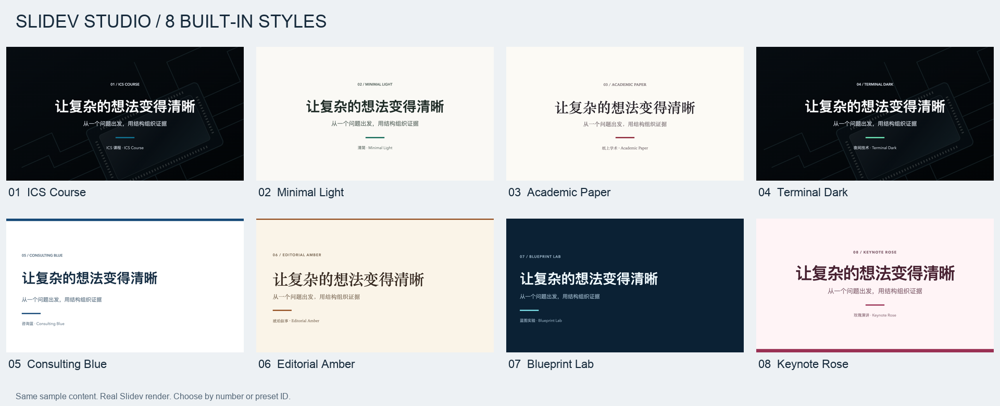

# Slidev Studio

[中文](#中文) · [English](#english) · [Agent installation / Agent 安装](INSTALL.md) · [Releases](https://github.com/GabrielMu2006/slidev-studio/releases/latest)

## 中文

用 Markdown 和 Vue 制作、验证和导出 Slidev 演示；从 **8 套内置风格模板** 中选取起点，也可以让 agent 从参考 PPT 提炼完整可复用模板。

插件包含两项统一版本的 skill：`slidev` 负责创作、可视化风格选择器、代码动画、公式、图表、交互与导出；`slidev-template-import` 负责检查参考文件、实现原生布局/组件/样式/素材、视觉验证、完整模板入库和复用。设计判断由 agent 完成，Python 工具负责检查和打包，无隐藏模型 API。

### 让 agent 从 GitHub 安装

把这句话发给有终端和网络权限的 agent：

> 请访问 https://github.com/GabrielMu2006/slidev-studio ，阅读根目录 INSTALL.md，根据当前 agent 宿主安装 Slidev Studio，验证两项 skill 和八套内置风格可用；如果已经安装则按文档更新。不要再安装一份重复的全局 skill。

[INSTALL.md](INSTALL.md) 包含 Codex、Claude Code、Cursor 和通用 Agent Skills 的安装、更新、验证和故障处理。只访问网页的聊天机器人仍需要本地工具权限才能执行安装。

Codex 可直接执行：

```bash
codex plugin marketplace add GabrielMu2006/slidev-studio
codex plugin add slidev-studio@slidev-local --json
codex plugin list --marketplace slidev-local --json
```

Claude Code 可执行 `claude plugin install slidev-studio --marketplace GabrielMu2006/slidev-studio`，或在会话内执行同样的 `/plugin install` 命令。Cursor / 通用宿主可克隆仓库后使用 `scripts/install_agent.py`；具体命令见安装文档。安装完成后新建聊天以刷新技能列表。

### 八套内置风格

这里的八套是可视化选择器中的**风格预设**：组合配色、字体、留白、标题与封面排版；agent 从 PPT 提炼的**完整布局模板包**单独入库，数量不限。预览使用同一组示例内容，便于筛选。



| 编号 | 名称 | 标识 | 风格与场景 |
| --- | --- | --- | --- |
| 1 | ICS 课程 / ICS Course | `ics-course` | 深色封面、白底内容、青蓝渐变标题。适合中文课程与教学。 |
| 2 | 清简 / Minimal Light | `minimal-light` | 暖白底、墨绿强调、清晰的叙事层级。适合分享与产品讲解。 |
| 3 | 纸上学术 / Academic Paper | `academic-paper` | 纸色背景、深红标题、衬线风格。适合组会、论文与学术报告。 |
| 4 | 夜间技术 / Terminal Dark | `terminal-dark` | 深色画布、浅色代码、青绿强调。适合技术会议与代码演示。 |
| 5 | 咨询蓝 / Consulting Blue | `consulting-blue` | 白底深蓝、左对齐封面、标题分隔线。适合业务汇报与决策建议。 |
| 6 | 琥珀叙事 / Editorial Amber | `editorial-amber` | 奶油纸色、琥珀强调、衬线标题与编辑式留白。适合人文与案例叙事。 |
| 7 | 蓝图实验 / Blueprint Lab | `blueprint-lab` | 海军蓝网格、青色标注、等宽标题。适合架构、工程和实验过程。 |
| 8 | 玫瑰演讲 / Keynote Rose | `keynote-rose` | 浅玫瑰底、莓红大标题、舞台式留白。适合观点演讲与产品发布。 |

查看 [逐套封面与内容页](docs/TEMPLATES.md)。默认先保留八套，可按编号/标识提出保留清单。每套都可调整颜色、字号、字体、留白、比例、转场、页码和版式气质，并另存为项目预设。

### 使用与更新

示例：“读取这份 PPT，提炼封面、章节、图文和表格布局，制作完整 Slidev 模板并加入我的模板库。”然后：“选择刚才导入的模板，创建一份新演示。”

在插件目录中：

```bash
python3 skills/slidev/scripts/studio.py serve /path/to/talk --no-browser
python3 skills/slidev/scripts/studio.py new ./talk --template editorial-amber --title "让复杂的想法变得清晰"
python3 skills/slidev-template-import/scripts/inspect_pptx.py reference.pptx --out ./analysis --render
python3 skills/slidev-template-import/scripts/template_bundle.py list --library ./my-template-library
```

更新 Codex 插件与两项 skill：

```bash
codex plugin marketplace upgrade slidev-local
codex plugin add slidev-studio@slidev-local
```

一个 VERSION 同步插件清单、skill 元数据和内容哈希；匹配的版本 tag 通过跨平台测试后发布 ZIP 和 SHA256SUMS。用户的完整模板库放在插件缓存之外，使用不可覆盖的独立模板版本。更新机制及其他宿主命令见 [UPDATING.md](docs/UPDATING.md)。

### 依赖、边界与开发

工具需要 Python 3.9+；演示项目需要符合 CLI 要求的 Node（验证基线 Slidev 53.0.0 / Node >=22.12.0）。PPTX 源文件渲染可用 LibreOffice + Poppler 或宿主自带工具；CLI 导出需要 Playwright/Chromium。仅提取 XML 的模板保持草稿状态，经过真实构建和视觉检查才可标记为已验证。

静态导出与实时网页交互不同。Slidev 普通 PPTX 使用渲染图片；对可编辑导出需先检查所装 CLI 是否支持，再验证实际结果。完整模板 ZIP 含保留的参考文件，分享前应确认用户已要求公开这些资料。

兼容性与验证范围见 [COMPATIBILITY.md](docs/COMPATIBILITY.md)。开发命令见下方 English 的 Development；两种语言共用同一套源码和安装路径。

## English

Create, verify and export Slidev presentations with Markdown and Vue. Start from **8 built-in style presets**, or ask your agent to distill a complete reusable template from a reference PowerPoint.

Two coordinated skills ship together: `slidev` covers authoring, the visual preset picker, code animation, math, diagrams, interactions and exports; `slidev-template-import` inspects references, implements native layouts/components/styles/assets, verifies them, and registers full template bundles for reuse. The agent interprets design; Python tools handle inspection and packaging, with no hidden model API.

### Let an agent install from GitHub

Send this to an agent with local terminal and network access:

> Visit https://github.com/GabrielMu2006/slidev-studio and read INSTALL.md at the repository root. Install Slidev Studio for your current agent host, then verify both skills and the eight built-in presets. If already installed, follow the update path. Do not add a duplicate global skill copy.

[INSTALL.md](INSTALL.md) contains executable Codex, Claude Code, Cursor and generic Agent Skills paths, including update handling and post-install verification. A browser-only chatbot still needs local tool access to perform installation.

For Codex:

```bash
codex plugin marketplace add GabrielMu2006/slidev-studio
codex plugin add slidev-studio@slidev-local --json
codex plugin list --marketplace slidev-local --json
```

For Claude Code, run `claude plugin install slidev-studio --marketplace GabrielMu2006/slidev-studio`, or the equivalent `/plugin install` command inside a session. Cursor/generic hosts clone this repository and use `scripts/install_agent.py`; see the installation guide. Start a fresh chat after installation to refresh skill discovery.

### Eight built-in styles

The eight items below are **style presets** in the visual picker: palettes, fonts, spacing, headings and cover composition. **Full layout bundles** distilled from PPT references use a separate, unlimited template library. Previews use matching sample content for comparison; [inspect covers and content pages](docs/TEMPLATES.md).

| # | Name | ID | Style and use |
| --- | --- | --- | --- |
| 1 | ICS Course / ICS 课程 | `ics-course` | Dark illustrated cover, white content, cyan headings for teaching. |
| 2 | Minimal Light / 清简 | `minimal-light` | Warm white, green accents and restrained sans-serif type for general talks. |
| 3 | Academic Paper / 纸上学术 | `academic-paper` | Paper, deep red and serif type for research presentations. |
| 4 | Terminal Dark / 夜间技术 | `terminal-dark` | Dark canvas, mint accents and light code for technical demonstrations. |
| 5 | Consulting Blue / 咨询蓝 | `consulting-blue` | White and navy, left-aligned covers and ruled headings for business decisions. |
| 6 | Editorial Amber / 琥珀叙事 | `editorial-amber` | Cream paper, amber accents and editorial serif hierarchy for stories and case studies. |
| 7 | Blueprint Lab / 蓝图实验 | `blueprint-lab` | Navy grids, cyan annotations and monospaced headings for architecture and engineering. |
| 8 | Keynote Rose / 玫瑰演讲 | `keynote-rose` | Pale rose, large berry headings and open poster composition for keynotes and launches. |

All eight are initially included for review. Choose by number/ID, adjust settings in the picker, and save project-specific variants. ICS adapts general traits from [this public reference](https://slide.huh.moe/00/1) with original SVG cover art; the other designs are original preset compositions.

### Use and update

Example: “Extract a reusable Slidev template from this PowerPoint, verify it, add it to my library, then create a new talk in that style.” From the plugin directory:

```bash
python3 skills/slidev/scripts/studio.py serve /path/to/talk --no-browser
python3 skills/slidev/scripts/studio.py new ./talk --template blueprint-lab --title "Make complex ideas clear"
python3 skills/slidev-template-import/scripts/inspect_pptx.py reference.pptx --out ./analysis --render
python3 skills/slidev-template-import/scripts/template_bundle.py list --library ./my-template-library
```

To update the Codex plugin and both skills together:

```bash
codex plugin marketplace upgrade slidev-local
codex plugin add slidev-studio@slidev-local
```

A single VERSION controls manifests, skill metadata and content hashes. Matching version tags run the full compatibility test matrix before publishing archives and SHA256SUMS. Full user templates have independent immutable versions outside plugin caches. See [UPDATING.md](docs/UPDATING.md) for the maintainer workflow and other hosts.

### Requirements and limits

Python 3.9+ runs the tools. Decks need Node satisfying their CLI engines (tested baseline: Slidev 53.0.0 / Node >=22.12.0). Reference rendering uses optional LibreOffice + Poppler or a host renderer; CLI exports need Playwright/Chromium. XML-only extraction remains a draft until a real build and visual inspection pass.

Static exports differ from live web interactions. Ordinary Slidev PPTX uses rendered images; verify editable-export support against the installed CLI and actual output. Full template ZIPs retain reference files, so share them only when the user requested that source to be shared. See [COMPATIBILITY.md](docs/COMPATIBILITY.md) for exactly what was validated on each host.

### Development

```bash
python3 scripts/release.py sync 0.3.0
python3 -m unittest discover -s plugins/slidev-studio/tests -v
python3 -m unittest discover -s tests -v
python3 scripts/release.py validate
python3 scripts/release.py build
```

MIT; [LICENSE](plugins/slidev-studio/LICENSE) and [NOTICE](plugins/slidev-studio/NOTICE.md). Syntax references derive from the official Slidev skill. Independent project; not an official Slidev or OpenAI plugin.
