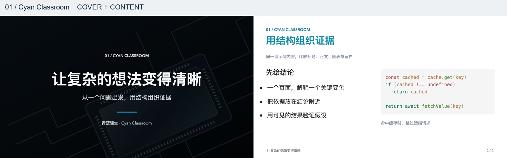
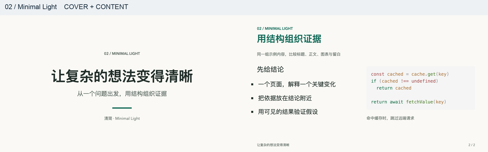
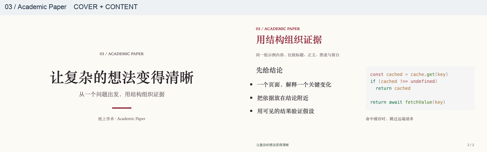
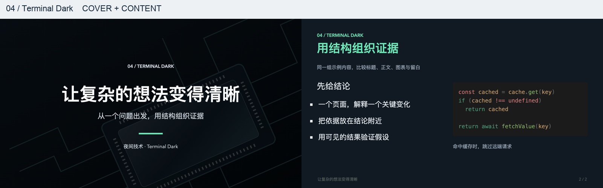
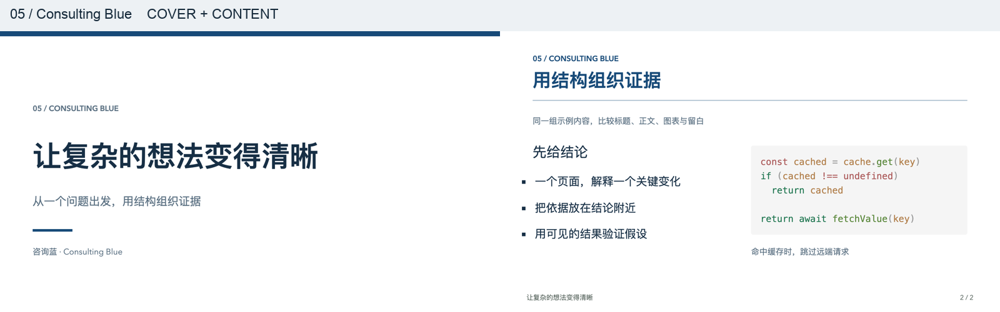
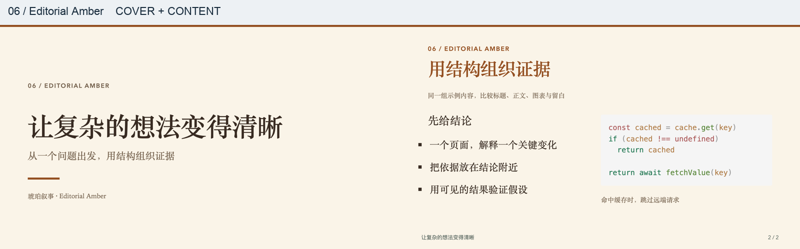
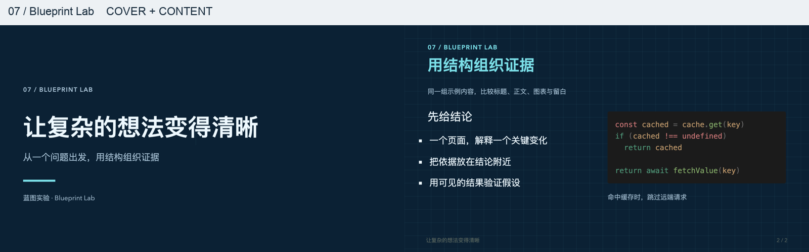
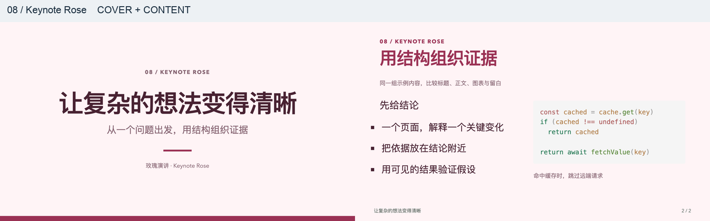

# 八套模板预览 / Eight style previews

八套均为内置风格预设；完整 PPT 布局模板通过独立导入 skill 生成。以下是同一组内容的真实 Slidev 封面与内容页。八套全部保留，第 1 套固定命名青蓝课堂。

These eight items are built-in style presets. Full PPT-derived layout templates use the separate import skill. Each pair shows actual Slidev cover/content renders with matching sample content. All eight are retained; preset 1 is Cyan Classroom.

## 1. 青蓝课堂 / Cyan Classroom

`cyan-classroom` · 深色封面、白底内容、青蓝渐变标题。适合中文课程与教学。

Dark illustrated cover, white content, cyan headings for teaching.

## 2. 清简 / Minimal Light

`minimal-light` · 暖白底、墨绿强调、清晰的叙事层级。适合分享与产品讲解。

Warm white, green accents and restrained sans-serif type for general talks.

## 3. 纸上学术 / Academic Paper

`academic-paper` · 纸色背景、深红标题、衬线风格。适合组会、论文与学术报告。

Paper, deep red and serif type for research presentations.

## 4. 夜间技术 / Terminal Dark

`terminal-dark` · 深色画布、浅色代码、青绿强调。适合技术会议与代码演示。

Dark canvas, mint accents and light code for technical demonstrations.

## 5. 咨询蓝 / Consulting Blue

`consulting-blue` · 白底深蓝、左对齐封面、标题分隔线。适合业务汇报与决策建议。

White and navy, left-aligned covers and ruled headings for business decisions.

## 6. 琥珀叙事 / Editorial Amber

`editorial-amber` · 奶油纸色、琥珀强调、衬线标题与编辑式留白。适合人文与案例叙事。

Cream paper, amber accents and editorial serif hierarchy for stories and case studies.

## 7. 蓝图实验 / Blueprint Lab

`blueprint-lab` · 海军蓝网格、青色标注、等宽标题。适合架构、工程和实验过程。

Navy grids, cyan annotations and monospaced headings for architecture and engineering.

## 8. 玫瑰演讲 / Keynote Rose

`keynote-rose` · 浅玫瑰底、莓红大标题、舞台式留白。适合观点演讲与产品发布。

Pale rose, large berry headings and open poster composition for keynotes and launches.

## 验证 / Validation

构建通过，16 页实际 PNG 已逐页检查；选择器支持八项并已实际创建蓝图模板项目。新 composition 设置兼容旧预设，旧文件缺少该字段时使用经典版式。预览不承诺任意文字长度均适配；制作真实内容后仍需检查换行和溢出。

The build passed and all 16 exported PNGs were inspected. The picker exposes all eight items and created a Blueprint Lab project. Legacy saved presets inherit classic composition when the new setting is absent. Real content still needs wrapping/overflow checks; these examples do not guarantee every text length will fit.
