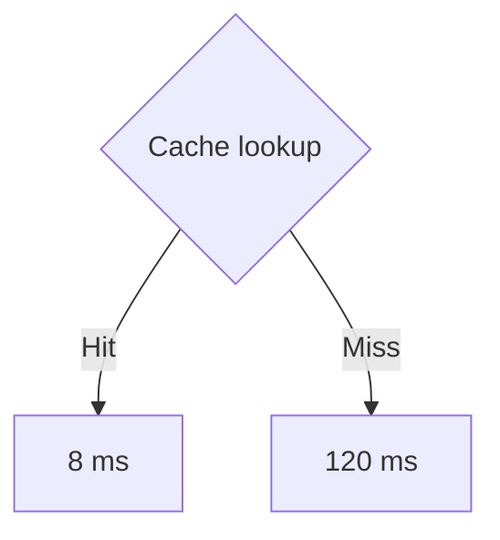

<div class="eyebrow">A small model · an executable explanation</div>

# {{ $slidev.configs.title }}

Use a cache to connect an implementation, a model, and a live experiment.

<div class="cover-rule"></div>
<div class="caption">Illustrative assumptions throughout · not benchmark measurements</div>

<!--
Start with the question: what changes when more requests hit a cache?
This is an example deck. Replace its title, story, visuals and notes for the audience.
-->

---
layout: two-cols-header
---

<div class="eyebrow">01 · Follow the boundary</div>

# Return early when the value is cached

::left::

```ts {2|3|4-6|all}{at:1,lines:true}
async function getValue(key: string) {
  const cached = cache.get(key)
  if (cached !== undefined) return cached
  const value = await fetchValue(key)
  cache.set(key, value)
  return value
}
```

::right::

<div v-click="1" class="explanation">Look up a previously stored value.</div>
<div v-click="2" class="explanation">A hit skips the origin request.</div>
<div v-click="3" class="explanation">A miss fetches, stores, and returns.</div>

<div class="caption">Assume a valid cache entry: expiry and invalidation are separate concerns.</div>

<!--
The cache and origin functions are illustrative interfaces.
[click] Locate the lookup.
[click] Emphasize the early return, including valid falsy values.
[click] Follow the miss path.
[click] Read the complete control flow once.
-->

---

<div class="eyebrow">02 · Evolve the implementation</div>

# Add the fast path without hiding the slow path

````md magic-move {duration:500}
```ts
async function getValue(key: string) {
  return await fetchValue(key)
}
```
```ts
async function getValue(key: string) {
  const cached = cache.get(key)
  if (cached !== undefined) return cached
  const value = await fetchValue(key)
  cache.set(key, value)
  return value
}
```
````

<div class="caption">Use the transition to explain a single change; keep production edge cases in the discussion.</div>

<!--
Describe the original behavior before advancing the code.
[click] The new early return bypasses the expensive call on a hit.
This deliberately omits invalidation and concurrent request deduplication.
-->

---
layout: two-cols-header
---

<div class="eyebrow">03 · Connect structure and arithmetic</div>

# The hit rate weights two different costs

::left::



::right::

$$ {1|2|all}
\begin{aligned}
T &= hT_{hit} + (1-h)T_{miss} \\
  &= 0.8(8) + 0.2(120) \\
  &= 30.4\,\mathrm{ms}
\end{aligned}
$$

<div class="caption">h = hit rate. Miss cost includes the lookup. Fixed costs; no queueing or warm-up effects.</div>

<!--
First trace the two branches.
[click] Substitute the illustrative values.
[click] Compare the weighted mean with a 120 ms miss.
-->

---

<div class="eyebrow">04 · Change one assumption</div>

# Move the hit rate and predict the result

<RenderWhen context="print">
  <div class="static-result">
    <span class="caption">Reference state · 80% cache hits</span>
    <strong>30.4 <small>ms</small></strong>
    <p>80% × 8 ms + 20% × 120 ms = 30.4 ms</p>
    <p>The mean falls linearly as the hit rate increases.</p>
  </div>
  <template #fallback><LatencyDemo /></template>
</RenderWhen>

<div class="caption">This model illustrates a tradeoff; it does not predict tail latency.</div>

<!--
Ask for a prediction before moving the slider. Start at 80%, then try 0% and 100%.
If the interaction fails, use the 30.4 ms reference state and explain the two endpoints.
Reset to 80% before handing the deck to someone else.
-->

---
class: starter-ending
---

<div class="eyebrow">Take the explanation with you</div>

# A useful demo makes its assumptions visible

<v-clicks>

- Trace the code path.
- State the model and its limits.
- Change one parameter and compare the result.

</v-clicks>

<div class="caption">Keep a static reference state in every exported handout.</div>

<!--
[click] Recall the early return.
[click] Recall the fixed-cost assumptions.
[click] Invite the audience to challenge those assumptions.
-->
