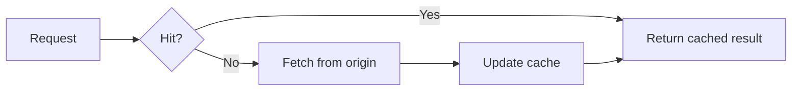

# Feature recipes

Combine native features into explanations. Adapt the examples to the subject; individual references remain the compact syntax lookup.

## Code walkthrough with synchronized commentary

Use shared absolute `at` values for synchronized code and annotations. Relative positions need quoted strings.

````md
---
layout: two-cols-header
---
# Validate before changing state

::left::

```ts {1|2|all}{at:1,lines:true}
const input = parse(raw)
const next = validate(input)
state.value = next
```

::right::

<div v-click="1">Convert the external representation.</div>
<div v-click="2">Reject invalid input before committing.</div>
<div v-click="3">Commit only after checks pass.</div>

<!--
Introduce the boundary before advancing.
[click] Explain parsing.
[click] Explain validation.
[click] Show the committed result.
-->
````

Inspect every step: independent absolute and relative sequences can leave gaps. `v-click="[1,3]"` is visible at clicks 1 and 2. See [animations](core-animations.md) and [click markers](animation-click-marker.md).

## Show an implementation changing

Magic Move makes a refactor visible. Keep each semantic change small.

`````md
````md magic-move {duration:500}
```ts
const total = items.reduce((sum, item) => sum + item.price, 0)
```
```ts
const total = items
  .filter(item => item.inStock)
  .reduce((sum, item) => sum + item.price, 0)
```
````
`````

Four outer backticks are required. Test the final exported state and `--with-clicks` when intermediate versions matter. Title bars, copy behavior, and advanced Shiki options are version-sensitive; see [Magic Move](code-magic-move.md).

## Teach types, compare code, and run code

| Question | Mechanism | Constraint |
| --- | --- | --- |
| Which type did the compiler infer? | `ts twoslash` and `// ^?` | Code must type-check; use documented annotations for intentional errors. |
| What changed? | `{monaco-diff}`, `~~~` separating versions | Editors are heavier than static highlighted code. |
| What if this input changes? | `{monaco-run}` | Browser JS/TS; no Node `fs` or process environment. |
| Can the audience edit it? | `{monaco}` | Types need local dependencies or a verified CDN source. |
| Can the presenter edit a local file? | `<<< ./file.ts {monaco-write}` | Development file writes, not a static-host capability. |

````md
```ts {monaco-run} {autorun:false}
const hitRate = 0.8
const latency = hitRate * 8 + (1 - hitRate) * 120
console.log(`${latency.toFixed(1)} ms`)
```
````

JS/TS runners execute without a security sandbox; run trusted demo code. For Python or another language, implement and verify a runner in `setup/code-runners.ts`; labelling a fence `python {monaco-run}` does not install a runtime. See [runner setup](https://sli.dev/custom/config-code-runners). Avoid auto-running side effects or long tasks. Include the expected result in notes or static content.

## Walk through a derivation

Use KaTeX `aligned` rows and highlight stages. Explain symbols and assumptions outside the formula.

```md
$$ {1|2|all}
\begin{aligned}
T &= hT_{hit} + (1-h)T_{miss} \\
  &= 0.8 \times 8 + 0.2 \times 120 = 30.4\,\mathrm{ms}
\end{aligned}
$$
```

KaTeX is not a complete TeX installation. Configure macros in `setup/katex.ts` when needed. Generate real scientific plots with readable labels rather than approximating data in decorative CSS. See [math](diagram-latex.md).

## Diagrams that belong to the theme

````md

````

`setup/mermaid.ts` and `defineMermaidSetup` configure shared theme variables. Slidev 53 uses Mermaid 12; inspect rendered labels. Alternate renderers use `setup/mermaid-renderer.ts` and `defineMermaidRendererSetup` only where installed types support it. See [extensions](project-and-extensions.md).

PlantUML normally sends diagram text to its configured server. Use Mermaid, a pre-rendered local SVG, or a suitable local PlantUML service when network or confidentiality requirements make that inappropriate.

## A Vue simulation with a handout alternative

Put behavior in `components/LatencyDemo.vue`; the starter includes an accessible working example. Components here are auto-imported.

```md
<RenderWhen context="print">

At an 80% hit rate, illustrative mean latency is **30.4 ms**.
The model assumes an 8 ms cache hit and a 120 ms cache miss.

<template #fallback><LatencyDemo /></template>
</RenderWhen>
```

Use the `fallback` slot so the print and live cases are mutually exclusive: print mode can still have a `slide` render context. Check both routes and the requested export. Keep assumptions visible live. If an export still renders the component, use a stable default state and explicit export prop rather than capturing an arbitrary edited value. Entering a slide is not equivalent to mounting a Vue component.

## Tabs, media, and annotations

- Enable `comark: true` before using `::code-group`. Static exports may capture only the active tab; use separate slides if the handout needs both.
- `<SlidevVideo>` supports talk-controlled video. Provide a local poster and textual takeaway; test codecs, autoplay permissions, pause/reset behavior, and exported poster. Iframes may be blocked by the target's frame policy; provide a link and screenshot fallback.
- Use rough markers or arrows to highlight evidence, and drawings for live annotation. Save needed annotations deliberately.
- Prefer deterministic local examples when remote APIs add no teaching value.

Sources: [animations](https://sli.dev/guide/animations), [code evolution](https://sli.dev/features/shiki-magic-move), [Monaco](https://sli.dev/features/monaco-editor), [runner](https://sli.dev/features/monaco-run), [math](https://sli.dev/features/latex), [components](https://sli.dev/builtin/components).
